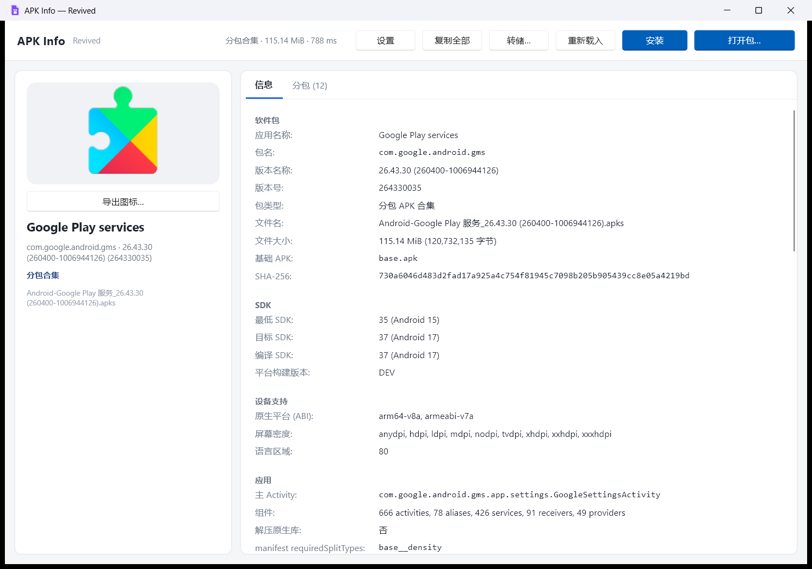
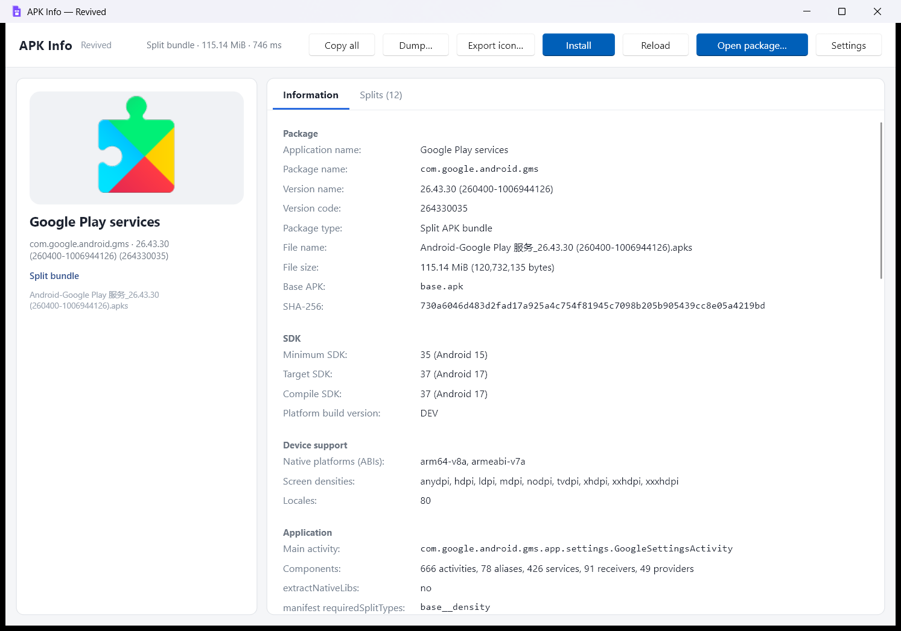
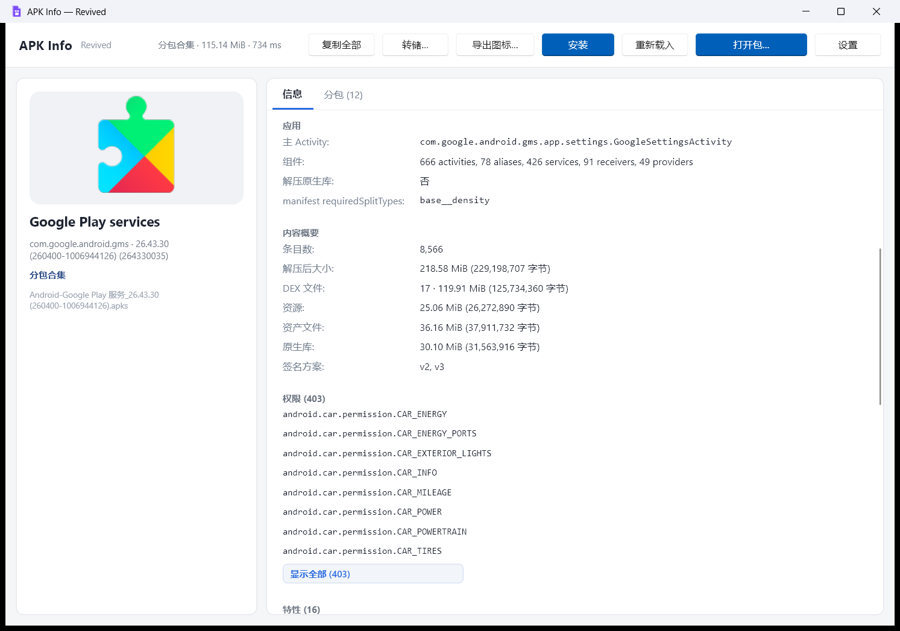
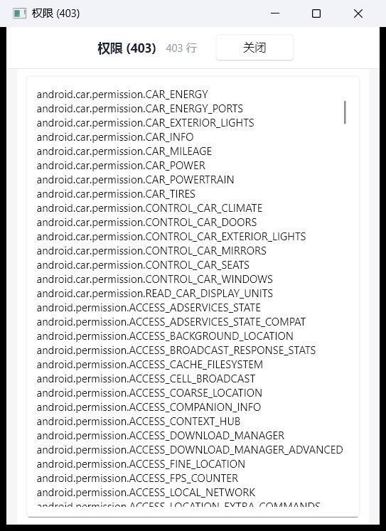
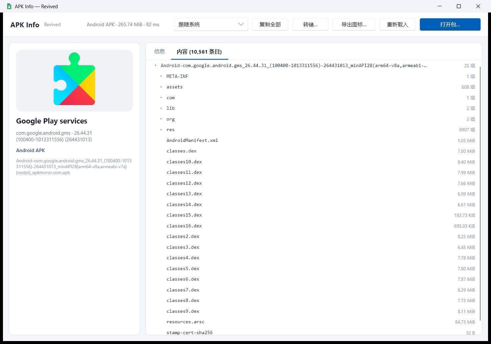
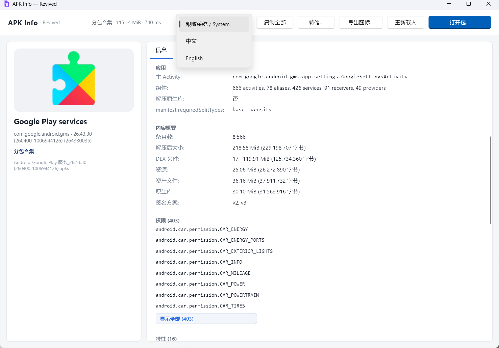
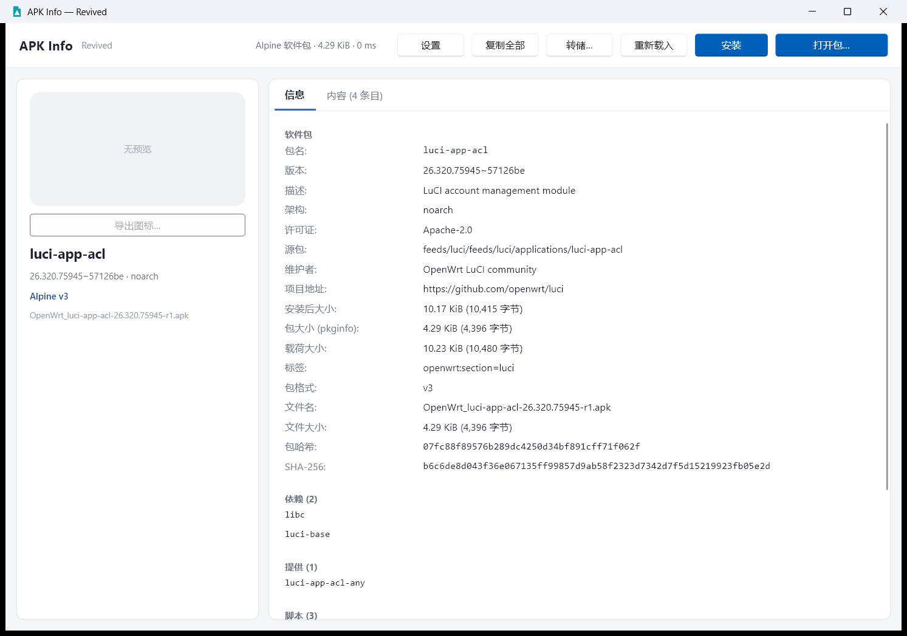
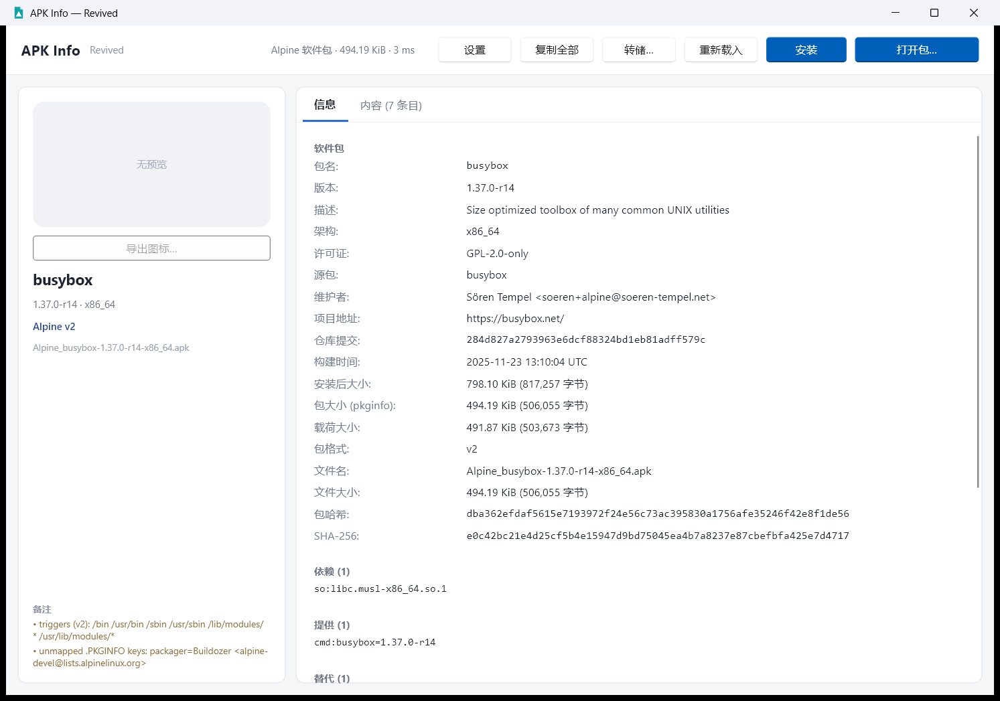
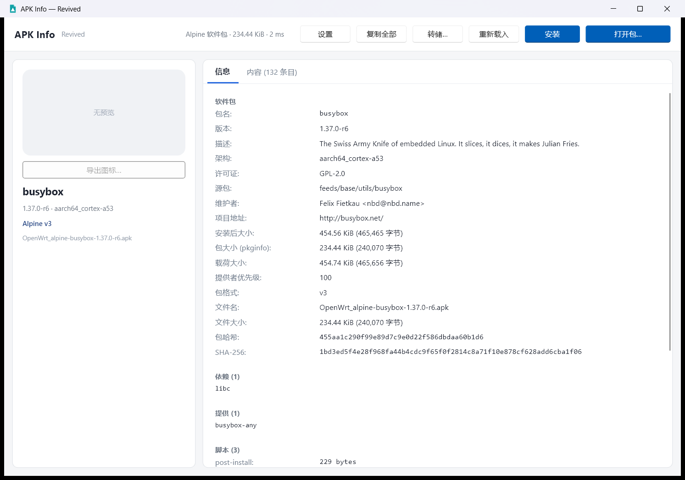
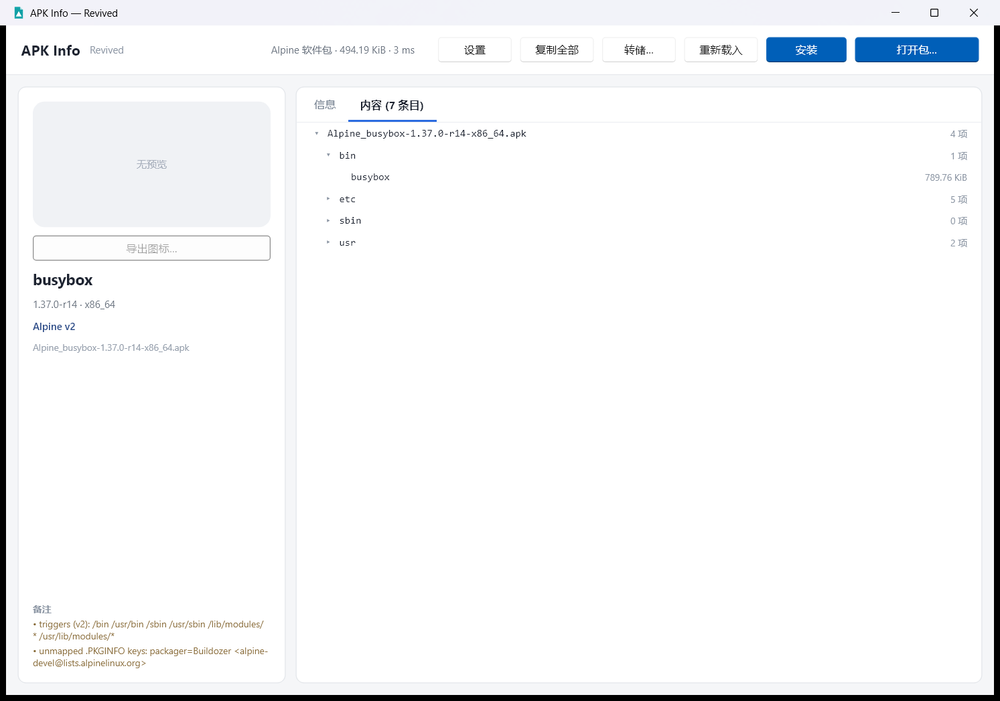

# APK Info — Revived

[简体中文](README.md) · **English**

A single-file info viewer for **two unrelated package formats that share the `.apk`
extension**:

| | Android package | Alpine package |
|---|---|---|
| container | zip | ADB block container (apk-tools 3.x) or concatenated gzip/tar streams (2.x) |
| reads | `AndroidManifest.xml` (binary XML) + `resources.arsc` | `adb` object tree / `.PKGINFO` + tar index |

The file type is decided from the **content**, never from the extension
(`src/detect.cpp`), and each format has its own independent parser. Only the result
screen is shared (`model/info_document.h`).

The UI is available in **English and Chinese** and follows the system language by
default (see [Localisation](#localisation)).

## Features

* **Detected from content.** Android and Alpine packages share the `.apk` extension;
  the program decides by looking at the file header, never at the name.
* **Android packages**: reads the binary `AndroidManifest.xml` and `resources.arsc` and
  reports the application name, package name, version name/code, package type, ABIs,
  screen densities, locales, component counts, permissions (including
  `uses-permission`, `uses-permission-sdk-23` and custom permissions), features, signature
  schemes and the DEX/resource/asset/native-library sizes.
* **Alpine packages**: name, version, description, arch, license, origin, maintainer, url,
  commit, sizes, dependencies / provides / replaces / install_if / recommends, scripts,
  signatures and the full file index — for both the v3 `adb` binary format and the classic
  v2 tar format.
* **`.apks` / `.apkm` / `.xapk` bundles**: the base apk is read as a normal package and the
  `split_*.apk` members are listed with their config type (ABI / density / locale /
  feature).
* **Launcher icons** are resolved through the resource table: adaptive icons, icons whose
  layers are WebP, vector layers and icons that only exist in a configuration split all
  work, and the icon can be exported as a PNG.
* **A built-in vector rasteriser** handles SVG paths (arcs and smooth-curve variants
  included), `<group>` transforms, fill/stroke/alpha/fill rules — no external tool needed.
* **Densities and locales** come from the `resources.arsc` configuration entries, so they
  stay visible even when the resource names are obfuscated.
* **The file listing is a collapsed tree**; clicking a directory expands it one level, with
  entry counts, uncompressed sizes and per-category sizes alongside.
* **Long lists are never truncated**: a section with too many entries renders its first 8
  and moves the rest into a separate window where the whole list can be selected and copied.
* **Report export**: copy the complete report to the clipboard, or save it as `.txt` /
  `.json`.
* **Large packages stay responsive**: the document is parsed once; switching language,
  expanding the tree and copying the report all re-render instead of re-reading the file.
* **Bilingual UI**: English / Chinese, following the system language by default, switchable
  from a toolbar dropdown that remembers the choice.
* **`apkinfo-config.json`** holds the language preference and the Android version-name
  table; edits take effect on the next start, no rebuild needed.

Everything is parsed from the file itself: **no aapt, no 7z, no network.**

## Screenshots

| | |
|---|---|
|  |  |
| the main window: icon and app summary on the left, sections on the right (follows the system language) | the same window in English; the dropdown follows with *Follow system* |
|  |  |
| a long list renders its first 8 entries, then a `Show all (403)` button | the button opens a window with the whole list in one selectable text box |
|  |  |
| the file listing is a collapsed tree (26 rows out of 10 561 entries); a click expands a directory | the language dropdown: follow the system / 中文 / English |
|  |  |
| an Alpine package: `noarch`, architecture-independent (an OpenWrt LuCI module) | an Alpine package: `x86_64`, v2 tar format (the official busybox) |
|  |  |
| an Alpine package: `aarch64_cortex-a53`, v3 format (OpenWrt's busybox) | the file index of an Alpine package; `bin` expanded shows busybox |

## Building

Requirements:

* Visual Studio 2022 (MSVC 14.4x) with the Windows 10/11 SDK
* CMake ≥ 3.21
* [Slint C++ 1.13](https://github.com/slint-ui/slint/releases) prebuilt
  (`Slint-cpp-1.13.0-win64-MSVC-AMD64.exe` → installed to e.g. `D:\SDK\slint`)
* vcpkg ports: `zlib`, `libwebp`, `zstd`

```powershell
.\build.ps1                 # configure + build Release into .\build
.\build.ps1 -Clean          # wipe the build directory first
.\build.ps1 -Target apkinfo-cli
```

`build.ps1` finds Slint and vcpkg automatically (`$env:SLINT_DIR`, `$env:VCPKG_ROOT`,
then `D:\SDK\slint` / `D:\SDK\vcpkg`), passes `-DSlint_DIR=<slint>/lib/cmake/Slint` plus
the vcpkg toolchain, and copies the runtime DLLs (`slint_cpp.dll`, `libwebp.dll`,
`libsharpyuv.dll`, `zlib1.dll`, `zstd.dll`) next to the executables, so `build\Release` is
directly runnable and directly packable (`-NoDeploy` skips that step).

### Visual Studio Code

The project ships `CMakePresets.json` with two presets:

* **vs2022** — the Visual Studio generator, directory `build/` (same as `build.ps1`)
* **ninja** — Ninja into `build-ninja/`, for CMake Tools' default generator

A CMake build directory is bound to the generator that created it, so if CMake Tools
creates `build/` with Ninja, `build.ps1` would fail with *"does not match the generator
used previously"*. It now detects that (and recreates the directory by itself); still,
selecting the `vs2022` preset in VS Code keeps both workflows on the same directory.
`.\build.ps1 -Generator Ninja -BinDir build-ninja` builds the Ninja variant from the
command line.

Outputs:

* `build\Release\ApkInfo.exe` — the viewer (pass a package path on the command line, or
  use *Open package…*)
* `build\Release\apkinfo-cli.exe` — dumps everything the parsers found, for scripted
  regression checks (`--icon-out <dir>` also writes the extracted icon as PNG)

### Releases (GitHub Actions)

`.github/workflows/release.yml` replays the build on `windows-latest`: it installs Slint
C++ silently, installs the three vcpkg ports, runs `build.ps1 -Clean`, smoke-tests the
result and publishes `build\Release` as `APK-Info-Revived-<tag>-win64.zip` on a release.

```powershell
git tag v1.0.0
git push origin v1.0.0        # triggers the release
```

The workflow can also be started by hand from the Actions tab (`tag` defaults to
`v1.0.0`). The smoke test generates a minimal Alpine v2 package with
`tests/make_smoke_package.py`, asserts the CLI recognises it and that a plain file is
rejected — no sample packages or aapt2 toolchain needed.

## Using it

* **Open a package**: pass a path on the command line, or use *Open package…*; files can
  also be dragged onto the window.
* **Copy all**: puts the whole report (file listing included) on the clipboard; the button
  itself shows "Copied".
* **Dump…**: save the report as `.txt` or `.json`.
* **Export icon…**: write the resolved launcher icon as a PNG (disabled while no package
  is loaded or there is no icon).
* **Reload**: re-read the current file.
* **Show all (N)**: long lists (permissions, locales, …) show their first 8 entries as
  ordinary rows; the button opens a separate window with the complete list.
* Values in the information rows can be **selected and copied per row** (each row is its
  own read-only input, so a selection never spans rows).
* The file listing is a **collapsed tree**; clicking a directory expands or collapses it.

### File associations

```powershell
.\Register-FileAssociations.ps1              # register .apk / .apks / .apkm / .xapk for the current user
.\Register-FileAssociations.ps1 -DryRun      # show what would be registered, touch nothing
.\Unregister-FileAssociations.ps1            # undo (with a rollback backup)
```

Both scripts and their `icons\` folder ship **inside the release archive**, so an
extracted release can register itself: they look for `ApkInfo.exe` beside themselves and
fall back to `build\Release\ApkInfo.exe`, and likewise look for `icons\` before
`assets\icons\`. Archives downloaded from GitHub carry the mark of the web, so unblock
them first if Windows refuses to run them:

```powershell
Get-ChildItem | Unblock-File
```

Explorer picks a file-type icon from the **extension**, before the file is opened, so an
`.apk` cannot be shown as "Android" or "Alpine" — both use the same extension. The shell
icons therefore stay format-neutral, and the format-specific icons (green package / teal
mountain / purple bundle) switch the **window and taskbar icon** once a package is
opened.

## The configuration file

`apkinfo-config.json` lives **next to `ApkInfo.exe`** (never in the working directory, for
reading and writing alike) and holds everything that is meant to be changed without a
rebuild:

```json
{
  "_readme": ["...how to edit this file..."],
  "language": "auto",
  "androidVersions": { "34": "14", "35": "15", "36": "16" }
}
```

* Read on start; when it is missing the defaults are written (with the instructions
  above), so there is always something to edit.
* `language` is `auto` (follow the Windows UI language), `en` or `zh`. The toolbar
  dropdown writes this field, so the choice survives a restart.
* `androidVersions` maps an SDK level to the name shown after it (`"36": "16 (Baklava)"`
  is fine, a plain number like `"34": 14` also works). Levels missing from the file fall
  back to the built-in table, a later duplicate wins, and malformed entries are skipped.
* A broken document is **not** overwritten: the program keeps the defaults, shows the
  problem in the *Notes* area, and leaves the file for you to fix.
* Deleting the file restores the defaults. An `android-versions.txt` left over from the
  previous (plain-text) format is imported automatically the first time.

## Localisation

The toolbar has a language dropdown with three entries — *follow the system*, 中文,
English — and the choice is stored in `apkinfo-config.json`, so the default is "follow the
Windows UI language" until you pick something else.

* Every user-visible string goes through `TR("English source")`; the dictionary in
  `src/i18n.cpp` holds 169 entries, and the test suite asserts there are no duplicate
  keys and that every translation differs from its source string.
* `--lang zh|en` and the `APKINFO_LANG` environment variable still override the preference
  **for one run**, which is what the tests use.
* Strings the parsers emit as diagnostics (`Package::warnings`, and the `apk-tools`-level
  error text) intentionally stay in English: they describe the file being read, not the
  UI.

## Big packages: parsing once, rendering lazily

A modern package has ten thousand entries and hundreds of permissions, so the window does
four things to stay responsive:

* **Parse once, re-render for everything else.** The readers emit *English* (row labels,
  section titles, enumerated values are dictionary keys); translation happens in
  `src/main.cpp` when the rows are built. Switching the language therefore re-renders the
  cached document instead of re-reading the package: measured at **~1 ms** on a 120 MB
  Play services bundle.
* **The file listing is a collapsed tree.** `src/model/tree_builder.cpp` keeps names, sizes
  and node structure only. Children of a node are contiguous, a node knows its own subtree
  size, and the UI walks that structure expanding one directory at a time — so a 10 561
  entry apk shows 26 rows until something is opened.
* **A section with too many entries ends with a `Show all (N)` button.** The first 8
  entries are ordinary rows, rendered exactly like the basic information; the button opens
  **a separate window** (`TextViewer`) whose body is a single read-only text box with the
  complete list — selectable, `Ctrl+C`, own scrollbar. Nothing is truncated, and the
  information page stays short enough to scroll comfortably.
* **The SHA-256 row no longer blocks anything.** Hashing runs on a background thread and
  the row is filled in when it arrives, so the window is usable immediately; the digest is
  computed exactly once.

Measured on the 120 MB Play services bundle at 125% DPI: steady working set **~25 MB**,
peak ~151 MB (one-off page touching), language switch 0.6–1.0 ms.

## Icons

The window, taskbar and file-association icons are original artwork, generated by
`tools/make_icons.py` at nine sizes (16–256 px) plus `.ico`:

| icon | purpose |
|---|---|
| `app.ico` | the program |
| `apk.ico` | an Android package |
| `apks.ico` | a bundle (`.apks` / `.apkm` / `.xapk`) |
| `android.ico` | window/taskbar icon once an Android package is open |
| `alpine.ico` | window/taskbar icon once an Alpine package is open |

Regenerating:

```powershell
python tools\make_icons.py --preview   # redraw all icons (+ ASCII preview)
```

### Icon rendering: what is covered, what is not

Covered: `<adaptive-icon>`, `<vector>` (`M/L/H/V/C/S/Q/T/A/Z` including arcs and the
smooth-curve variants, `<group>` translate/scale/rotate/pivot, fill/stroke/alpha/`fillType`,
`@color` references), `<scale>`, `<bitmap>`, `<inset>`, `<nine-patch>`, `<layer-list>`,
`<color>`, and bitmaps (PNG/JPEG/GIF/BMP/WebP).

Not covered (these lose fidelity on some packages): a `<gradient>` fill falls back to its
start colour, `<clip-path>` is ignored, `android:tint`/`tintMode` are not applied,
`<animated-vector>`/`<rotate>`/`<level-list>`/`<selector>` are not decoded, `?attr/...`
theme colour references cannot be resolved, `android:roundIcon` is not preferred, and
adaptive icons are composited on the full 108dp canvas without the 1.5× scale-up and 72dp
safe-zone crop.

## Tests

```powershell
cd tests
.\run_tests.ps1                 # all parser/unit tests
.\run_tests.ps1 -Module arsc    # a single module
.\ui_flow.ps1                   # real UI flow (OCR + clicks)
.\ui_flow.ps1 -Lang zh
.\ui_perf.ps1                   # memory and language-switch timing
.\ui_icons.ps1                  # icon resources and associations
```

Unit/parser tests (`run_tests.ps1`, 9 modules):

| module | checks | what it covers |
|---|---|---|
| axml | 453 lines | line-by-line cross-check against aapt2's `xmltree` output |
| arsc | 53 | resource table parsing, 42 276 ids cross-checked, density/locale selection |
| alpine | 104 | v3 `adb` and v2 tar parsing, dependency relations, signature blocks |
| i18n | 349 | dictionary completeness, no duplicate keys, translations differ from sources |
| tree | 40 | tree building: contiguous children, subtree sizes, path assembly |
| report | 29 | text and JSON report formats |
| versions | 12 | legacy version-table parsing, built-in fallback |
| vector | 22 | path parsing, arc roundness and area, fill rules, transform order |
| config | 54 | JSON parsing, config creation/editing/broken-file fallback/saving/migration |

UI tests use PrintWindow + Windows OCR rather than pixel comparison: `ui_flow.ps1` runs 30
checks in each language, covering window centring, the Close button height, tree
expansion, copy/dump, per-row selection, and the language dropdown writing its choice to
the config file.

**Click safety:** the scripts move the real mouse and click at absolute coordinates, so
every click first raises the target window and verifies it really is the foreground window;
otherwise the run aborts with an exception instead of clicking into somebody else's window.

Test fixtures: `tests/fixtures/` is generated by `tests/prepare_fixtures.ps1`
(rebuilding them needs `aapt2.exe` and `7z.exe`: drop both into `<repo>\tools`, or point
`APKINFO_TOOLS` at the folder that holds them) from the
sample packages in `example/`. Both directories are in `.gitignore` and are not part of the
repository — put your own sample packages there.

## Repository layout

```
.                        repository root
  src/
    detect.cpp            content sniffing: Android / Alpine
    android/              axml, arsc, apk_reader, versions
    alpine/               v3 adb, v2 tar
    image/                stb_image/libwebp decoding, PNG writer, vector rasteriser
    model/                info_document, tree_builder, report
    util/                 json, hash, clipboard, text
    i18n.cpp              English/Chinese dictionary
    config.cpp            the configuration file
    app.cpp               Win32 details (icons, clipboard, save dialogs)
    main.cpp              Slint UI and state
  ui/main.slint           main window and TextViewer
  assets/icons/           icons (svg/png/ico + app.rc)
  tools/                  make_icons.py, cli.cpp
  tests/                  unit tests, UI tests, fixture preparation, screenshots
  docs/screenshots/       screenshots
```

## Known limitations

* Signatures are **reported, not verified** (v1 JAR, v2/v3 APK Signature Scheme and Alpine
  signature blocks are read out, but no cryptographic validation is performed).
* Alpine v3 payloads compressed with zstd need the `zstd` port (linked in by default);
  deflate and uncompressed containers always work.
* Alpine v3 has no `Package` fields for `triggers`, `replaces-priority` or `layer`: those
  are reported as parser warnings instead of silently dropped.
* The icon-rendering gaps are listed under *Icon rendering* above.

## Licence

The source code of this project is released under the **GNU General Public License,
version 3 only (GPL-3.0-only)** — see [LICENSE](LICENSE) for the full text:

> This program is free software: you can redistribute it and/or modify it under the terms
> of the GNU General Public License as published by the Free Software Foundation, **version
> 3 only**.

The UI toolkit [Slint](https://slint.dev/) is dual licensed (GPLv3 / commercial) and this
program links its GPLv3 build (`slint_cpp.dll`), so **distributed binaries are licensed
under GPL-3.0 as a whole**, which the licence above allows. Distributing a binary under
other terms requires a commercial Slint licence.

## Acknowledgements

* [Slint](https://slint.dev/) — the UI toolkit.
* [stb_image](https://github.com/nothings/stb) (Sean Barrett) — PNG/JPEG/BMP/GIF decoding.
* [libwebp](https://chromium.googlesource.com/webm/libwebp) (Google) — WebP decoding.
* [zlib](https://zlib.net/), [zstd](https://github.com/facebook/zstd) (Meta) — compression
  support.
* [aapt2](https://developer.android.com/studio) (Android SDK) — used only as a
  cross-checking reference in the tests.
