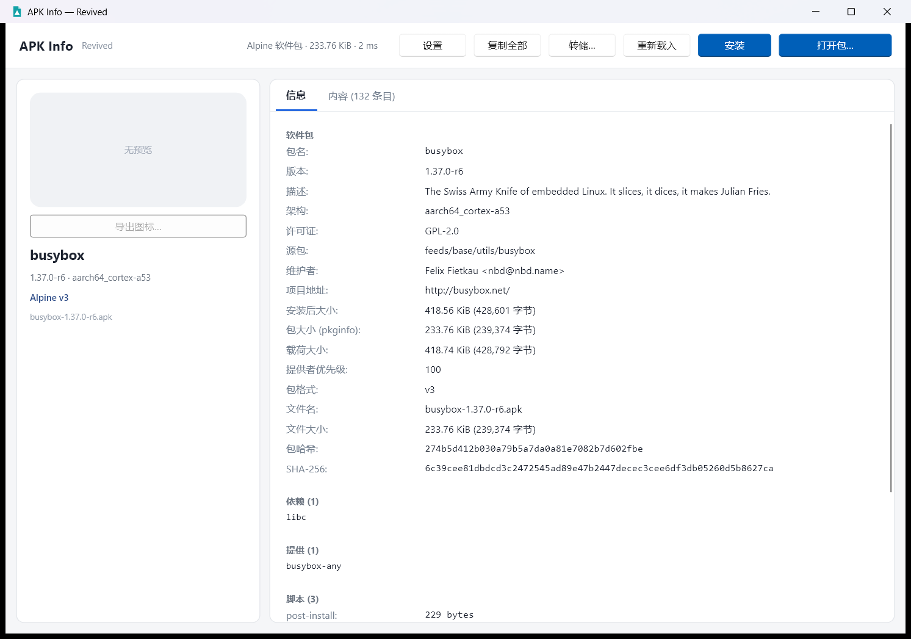

# APK Info — Revived

**在 Windows 上查看 Android 安装包和 Alpine Linux 软件包。**

[](https://github.com/drclefcxk/apk-info-revived/releases/latest)
[](https://github.com/drclefcxk/apk-info-revived/releases/latest)
[](LICENSE)

**简体中文** · [English](README.en.md)

[下载 Windows 版](https://github.com/drclefcxk/apk-info-revived/releases/latest) · [支持的格式](#支持的格式) · [从源码构建](#从源码构建) · [反馈问题](https://github.com/drclefcxk/apk-info-revived/issues)

Android 和 Alpine Linux 都使用 `.apk` 扩展名，但包格式完全不同。APK Info — Revived 根据文件内容识别格式，在同一个窗口里查看包元数据、浏览文件清单和导出报告。查看过程完全在本地完成，无需安装待查看的软件包，也无需 `adb`、`aapt` 或 7-Zip。


## 快速上手

1. 前往 [GitHub Releases](https://github.com/drclefcxk/apk-info-revived/releases/latest)，在 **Assets** 中下载 `APK-Info-Revived-<版本>-win64.zip`。
2. 解压整个压缩包，保留同目录的 DLL，然后运行 `ApkInfo.exe`。
3. 点击 **打开包…** 选择文件，也可以在启动时传入包路径。点击目录可展开文件清单；点击 **显示全部 (N)** 可查看和复制完整列表。

用 **复制全部** 把报告复制到剪贴板，或用 **转储…** 保存为 TXT 或 JSON。Android 启动图标可另存为 PNG。界面默认跟随 Windows 语言，也可在 **设置** 中切换简体中文或 English。

## 支持的格式

| 格式 | 可查看的信息 |
| --- | --- |
| Android APK (`.apk`) | 应用名、包名、版本、SDK 级别、ABI、屏幕密度、语言、权限、组件、启动图标、签名方案和文件清单。 |
| Android 分包归档 (`.apks`、`.apkm`、`.xapk`) | 基础 APK 的应用信息，以及各分包的 ABI、密度、语言或功能分类。 |
| Alpine Linux APK (`.apk`) | 包名、版本、架构、许可证、维护者、依赖关系、安装脚本、签名和文件清单。支持 apk-tools 2.x 的 gzip/tar 和 3.x 的 ADB 格式。 |

OpenWrt 从 25.12 起使用 `apk`。下图展示在 APK Info 中打开 OpenWrt 25.12.6 的 BusyBox 包（`aarch64_cortex-a53`，Alpine APK v3）：



签名信息仅供查看，不做密码学验证。部分 Android 图标效果（例如渐变、裁剪和主题颜色）可能与设备上的显示不同。

更多截图：[Alpine 包](docs/screenshots/alpine-x86_64-zh.png) · [文件树](docs/screenshots/tree-zh.png) · [Android 安装页](docs/screenshots/install-page-zh.png) · [设置页](docs/screenshots/settings-zh.png)

## 命令行

发布压缩包内的 `apkinfo-cli.exe` 可直接输出包信息，也可写入报告。下例中的 `sample.apk` 请替换为实际包路径：

```powershell
.\apkinfo-cli.exe .\sample.apk
.\apkinfo-cli.exe --dump-json .\report.json .\sample.apk
.\apkinfo-cli.exe --dump-txt .\report.txt .\sample.apk
```

使用 `--icon-out <目录>` 可将找到的启动图标写入已有目录。命令行输出使用英文，方便脚本处理。

## 可选功能

### 安装到设备

打开 Android 包后，点击工具栏的 **安装**。内置安装页通过 [Android SDK Platform-Tools](https://developer.android.com/tools/releases/platform-tools) 中的 `adb` 列出设备，支持无线调试的发现、配对和连接，并显示安装日志。单 APK 使用 `adb install`，含多个 APK 的分包归档使用 `adb install-multiple`。安装选项包括替换、授予权限、允许降级和允许测试包。

也可以在 **设置** 中为 Android 指定外部安装命令；Alpine 安装只使用外部命令，请按目标环境配置。设置页提供变量说明和当前包的命令预览。

放在网络共享里的包同样可以安装，包括 WSL 里的构建产物（`\\wsl.localhost\<发行版>\…`）：外部命令会改在临时目录执行，内置安装器会先把包复制出来。

<details>
<summary>配置文件、adb 路径和命令变量</summary>

`apkinfo-config.json` 首次启动时生成，保存在 `ApkInfo.exe` 同一目录。它保存语言、Android 版本显示名和安装选项。设置页保存后立即生效；也可以编辑 `androidVersions`，自定义 SDK 级别对应的显示名。

`adb` 按此顺序查找：设置中指定的路径、`ADB`、`ANDROID_HOME`、`ANDROID_SDK_ROOT`、`PATH`，最后查找常见的 SDK 目录。

外部命令直接启动（不经过 shell），沿用 APK Info 自己的工作目录，因此 `cmd.exe` 打不开的 UNC 路径（如 WSL 的 `\\wsl.localhost\…`）也能正常安装。常用变量有 `{path}`（包的完整路径）、`{exe_dir}`（ApkInfo.exe 所在目录，用于调用软件旁边的脚本）、`{file_name}`（文件名）、`{package_name}`（包名）、`{version}`（版本）、`{device}`（选中设备的序列号）和 `{adb}`（adb 路径）。路径可能含空格，在命令中使用 `"{path}"`。

</details>

### 在资源管理器中打开

发布包内附带两个 PowerShell 脚本。在解压目录中运行，可为当前用户注册或撤销 `.apk`、`.apks`、`.apkm`、`.xapk` 的文件关联：

```powershell
.\Register-FileAssociations.ps1 -DryRun
.\Register-FileAssociations.ps1
.\Unregister-FileAssociations.ps1
```

`-DryRun` 仅预览将进行的注册操作。

## 从源码构建

准备 Visual Studio 2022（**使用 C++ 的桌面开发**工作负载，包含 Windows SDK）、CMake 3.21 或更新版本、[Slint C++ 1.13.1（Windows MSVC x64）](https://github.com/slint-ui/slint/releases/tag/v1.13.1) 和 [vcpkg](https://github.com/microsoft/vcpkg)。以下路径为示例，请换成 SDK 的实际安装目录：

```powershell
git clone https://github.com/drclefcxk/apk-info-revived.git
Set-Location apk-info-revived

$env:SLINT_DIR = 'D:\SDK\slint'
$env:VCPKG_ROOT = 'D:\SDK\vcpkg'
& "$env:VCPKG_ROOT\vcpkg.exe" install zlib:x64-windows libwebp:x64-windows zstd:x64-windows
.\build.ps1
```

默认产物位于 `build\Release\`，包括 `ApkInfo.exe`、`apkinfo-cli.exe` 和运行所需的 DLL。`SLINT_DIR` 应指向 Slint 的安装根目录，`VCPKG_ROOT` 应指向已完成初始化的 vcpkg 目录。

<details>
<summary>编辑器、测试与发布</summary>

- [CMake 预设](CMakePresets.json)提供 `vs2022` 和 `ninja`。如需 clangd 的 `compile_commands.json`，请从 VS 2022 x64 开发环境运行 `cmake --preset ninja`，再执行 `cmake --build build-ninja`。预设使用 `D:/SDK` 下的 SDK 路径，可用 `-D` 参数覆盖。
- 完整解析回归需要 Python 3、`aapt2.exe`、`7z.exe` 和样本。把 `*Lawnchair*.apk`、`*alpine-busybox*.apk`（使用 deflate 压缩的 Alpine v3 包）和含 `base.apk` 的 `.apks` 放进仓库根目录的 `example/`。将 `APKINFO_TOOLS` 指向两个工具所在目录，再运行 `.\tests\prepare_fixtures.ps1 -Root (Get-Location).Path` 和 `.\tests\run_tests.ps1`。
- [发布工作流](.github/workflows/release.yml)在 Windows x64 上构建并打包，通过合成的 Alpine 软件包对 CLI 做冒烟测试。

</details>

## 贡献与许可

欢迎提交 [Issue](https://github.com/drclefcxk/apk-info-revived/issues) 或 Pull Request。报告解析问题时，请附上程序版本、包格式、复现步骤，以及可以公开分享的样本或下载地址。

项目采用 [GPL-3.0-only](LICENSE)。感谢 [Slint](https://slint.dev/)、[stb_image](https://github.com/nothings/stb)、[libwebp](https://chromium.googlesource.com/webm/libwebp)、[zlib](https://zlib.net/) 和 [zstd](https://github.com/facebook/zstd) 项目。
