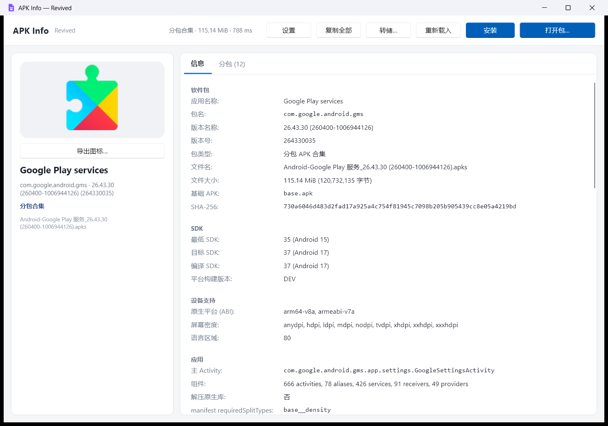
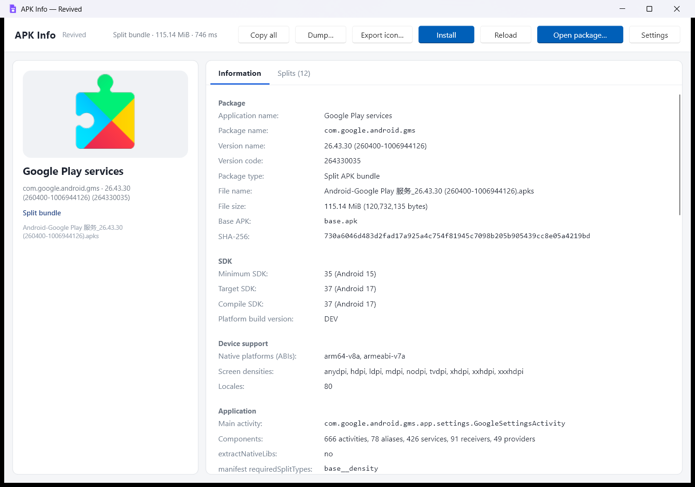
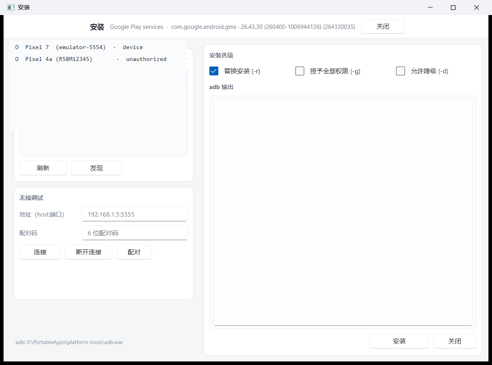
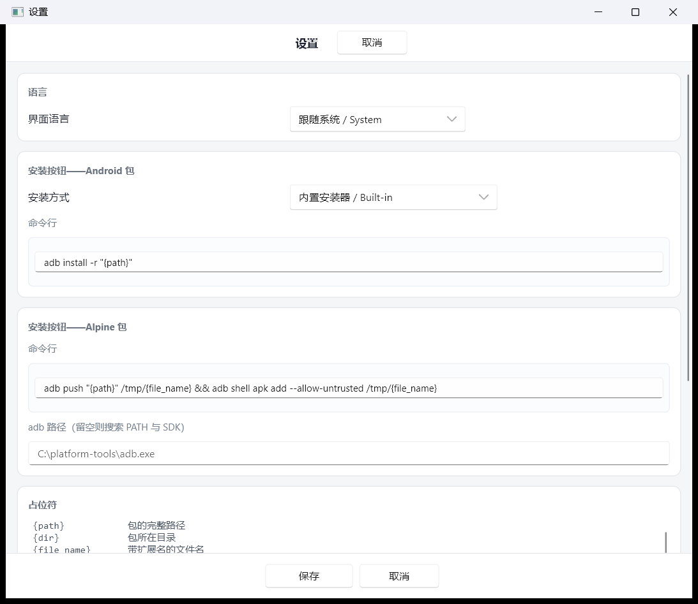
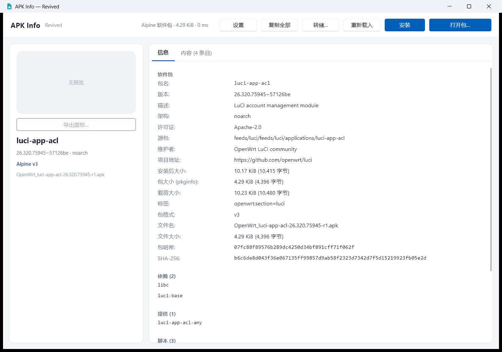
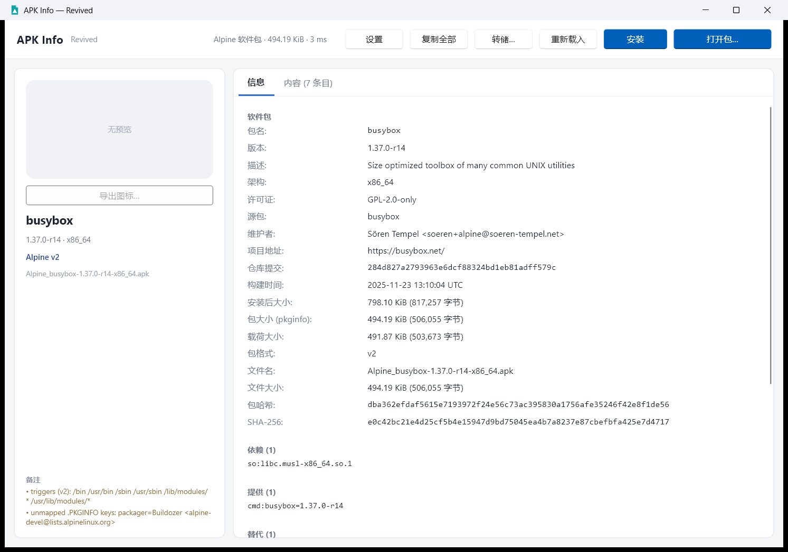

# APK Info — Revived

**简体中文** · [English](README.en.md)

一个用来查看**两种共用 `.apk` 扩展名、但毫无关系**的包格式的单文件信息阅读器：

| | Android 包 | Alpine 包 |
|---|---|---|
| 容器 | zip | ADB 块容器（apk-tools 3.x）或拼接的 gzip/tar 流（2.x） |
| 读取 | `AndroidManifest.xml`（二进制 XML）+ `resources.arsc` | `adb` 对象树 / `.PKGINFO` + tar 索引 |

文件类型由**内容**判定，从不看扩展名（`src/detect.cpp`）；两种格式各有独立解析器，只在结果界面这一层共享（`model/info_document.h`）。

界面为 **中文 / English** 双语，默认跟随系统语言（见[语言](#语言--localisation)）。

## 功能

* **格式判定靠内容。** Android 包与 Alpine 包共用 `.apk` 扩展名，程序按文件头判断，从不看文件名。
* **Android 包**：读取二进制 `AndroidManifest.xml` 与 `resources.arsc`，给出应用名、包名、版本名/号、包类型、ABI、屏幕密度、语言区域、组件统计、权限（含 `uses-permission`、`uses-permission-sdk-23`、自定义权限）、特性、签名方案、DEX/资源/资产/原生库体积等。
* **Alpine 包**：名称、版本、描述、架构、许可证、origin、维护者、地址、commit、体积、依赖 / provides / replaces / install_if / recommends、脚本、签名以及完整文件索引——v3 `adb` 二进制格式与经典 v2 tar 格式都支持。
* **`.apks` / `.apkm` / `.xapk` 分发包**：解出 `base.apk` 当普通包读取，各 `split_*.apk` 按配置类型（ABI / 密度 / 语言 / 功能）列出。
* **启动图标**：通过资源表解析 `android:icon`，支持自适应图标、图层为 WebP 的图标、矢量图层，以及只存在于配置分包里的图标；图标可一键导出为 PNG。
* **矢量图层自带光栅器**：解析 SVG 路径（含弧线与光滑曲线）、`<group>` 变换、填充/描边/透明度/填充规则，无需外部工具。
* **密度与语言**取自 `resources.arsc` 的配置项，资源名被混淆时同样可见。
* **文件清单是折叠树**，点目录逐层展开；条目数、解压后大小与各分区体积一并给出。
* **长列表不截断**：条目过多的区块只渲染前 8 条，其余进独立窗口，整份列表可全选复制。
* **报告导出**：整份信息可一键复制到剪贴板，或保存为 `.txt` / `.json`。
* **中大文件也不卡**：文档只解析一次，切换语言、展开树、复制报告都是重渲染，不重读文件。
* **界面双语**：中文 / English，默认跟随系统语言，可在设置页切换并记住选择。
* **一键安装**：工具栏的 *安装* 按钮把当前包装到设备上——Android 包可选择内置安装页（设备列表、无线调试、配对、安装选项、adb 日志）或自定义外部命令；Alpine 包始终走外部命令。
* **设置文件 `apkinfo-config.json`**：语言偏好与 Android 版本名对照表都在其中，改完即生效，无需重编译。

所有信息都从文件本身解析：**不用 aapt、不用 7z、不联网**。

## 截图

| | |
|---|---|
|  |  |
| 主窗口：左侧图标与应用信息，右侧分区信息（默认跟随系统语言） | 同一界面切到 English，语言下拉随之显示 *Follow system* |
|  |  |
| 长列表只渲染前 8 条，其后是 `显示全部 (403)` 按钮 | 按钮打开独立窗口，整份列表在一个可选中的文本框里 |
|  |  |
| 文件清单是折叠树（10 561 条目初始 26 行），点目录展开 | 安装页：设备列表、无线调试与配对、安装选项、adb 输出（设备行为示意） |
|  | |
| 设置页：语言、Android 安装方式与命令行、Alpine 命令、adb 路径、占位符参考 | |
|  |  |
| Alpine 包（`noarch`，与架构无关；OpenWrt 的 LuCI 模块） | Alpine 包（`x86_64`，v2 tar 格式；官方 busybox） |
|  |  |
| Alpine 包（`aarch64_cortex-a53`，v3 格式；OpenWrt 的 busybox） | Alpine 包的文件索引：折叠树，点开 `bin` 看到 busybox |

## 构建

依赖：

* Visual Studio 2022（MSVC 14.4x）与 Windows 10/11 SDK
* CMake ≥ 3.21
* 预编译 [Slint C++ 1.13](https://github.com/slint-ui/slint/releases)（`Slint-cpp-1.13.0-win64-MSVC-AMD64.exe`，安装到如 `D:\SDK\slint`）
* vcpkg 端口：`zlib`、`libwebp`、`zstd`

```powershell
.\build.ps1                 # 配置 + 构建 Release 到 .\build
.\build.ps1 -Clean          # 先清空构建目录
.\build.ps1 -Target apkinfo-cli
```

`build.ps1` 会自动查找 Slint 与 vcpkg（`$env:SLINT_DIR`、`$env:VCPKG_ROOT`，然后 `D:\SDK\slint` / `D:\SDK\vcpkg`），传入 `-DSlint_DIR=<slint>/lib/cmake/Slint` 与 vcpkg toolchain；构建完成后把运行库（`slint_cpp.dll`、`libwebp.dll`、`libsharpyuv.dll`、`zlib1.dll`、`zstd.dll`）复制到可执行文件旁，因此 `build\Release` 目录可以直接运行、也可以直接打包（`-NoDeploy` 可跳过这一步）。

### Visual Studio Code

`CMakePresets.json` 提供两个预设：

* **vs2022** — Visual Studio 生成器，目录 `build/`（与 `build.ps1` 相同）
* **ninja** — Ninja 生成到 `build-ninja/`，供 CMake Tools 的默认生成器使用

CMake 构建目录与创建它的生成器绑定，若 CMake Tools 用 Ninja 建了 `build/`，`build.ps1` 会报 *"does not match the generator used previously"*。脚本会检测到这一点并自行重建目录；但仍建议在 VS Code 里选 `vs2022` 预设，让两种方式共用一个目录。命令行构建 Ninja 变体：`.\build.ps1 -Generator Ninja -BinDir build-ninja`。

#### clangd

clangd 不读 MSVC 构建目录里的任何东西，它读的是**编译数据库** `compile_commands.json`。VS 生成器不产出这个文件，所以预设 `ninja` 打开了 `CMAKE_EXPORT_COMPILE_COMMANDS`，根目录的 `.clangd` 把 clangd 指向 `build-ninja/`：

```powershell
# 在 "x64 Native Tools Command Prompt for VS 2022" 里执行一次（需要 cl.exe 在 PATH 上）
cmake --preset ninja
cmake --build build-ninja        # 同时生成 Slint 的 main.h
```

这样 `src/*.cpp` 里的 `#include <slint.h>`、`<string>`、`<windows.h>` 都能解析——包括 Slint 的 include 目录（来自 `Slint::Slint` 目标）和 MSVC/Windows SDK 的系统头目录（后者原本只存在于 `cl.exe` 的 `INCLUDE` 环境变量里，clangd 继承不到，`CMakeLists.txt` 会把它们作为外部 include 写进数据库）。在 VS Code 里选 `ninja` 预设配置时 CMake Tools 也会带好 VS 环境，效果相同。

产物：

* `build\Release\ApkInfo.exe` — 查看器（可在命令行给一个包路径，或用 *打开包…*）
* `build\Release\apkinfo-cli.exe` — 输出解析器找到的全部信息，用于脚本化回归（`--icon-out <目录>` 还会把图标写成 PNG）

### 发布（GitHub Actions）

`.github/workflows/release.yml` 在 `windows-latest` 上把本项目的构建流程重放一遍：静默安装 Slint C++、用 vcpkg 装三件套、`build.ps1 -Clean`、冒烟测试，然后把 `build\Release` 打包成 `APK-Info-Revived-<tag>-win64.zip` 并作为 Release 资产发布。

```powershell
git tag v1.1.1
git push origin v1.1.1        # 触发发布
```

也可以在 Actions 页面手动 Run workflow（`tag` 默认 `v1.1.1`）。冒烟测试用 `tests/make_smoke_package.py` 现场生成一个最小 Alpine v2 包，断言 CLI 能识别它、并把普通文件判为"无法识别"，因此不需要任何样例包或 aapt2 工具链。

## 使用

* 工具栏从右到左是 **打开包…**、**安装**、**重新载入**、**转储…**、**复制全部**、**设置**（最左）。
* **打开包**：命令行传入路径，或点工具栏 *打开包…*；可直接从资源管理器拖进窗口。
* **复制全部**：把整份报告（含文件清单）复制到剪贴板，按钮上会显示"已复制"。
* **转储…**：保存 `.txt` 或 `.json` 报告。
* **导出图标…**：图标框正下方的按钮，把解析出的启动图标写成 PNG（未加载包或无图标时禁用）。
* **重新载入**：重读当前文件（内容被替换时用）。
* **显示全部 (N)**：长列表（权限、语言等）前 8 条按普通行显示，其余进独立窗口。
* 信息行里的值可以**按行选中复制**（每行一个只读输入框，选区不会跨行）。
* 文件清单是**折叠树**，点目录展开/收起。

### 文件关联

```powershell
.\Register-FileAssociations.ps1              # 为当前用户注册 .apk / .apks / .apkm / .xapk
.\Register-FileAssociations.ps1 -DryRun      # 只看会注册什么，不写注册表
.\Unregister-FileAssociations.ps1            # 撤销（带回滚备份）
```

这两个脚本与 `icons\` 都打进 **release 压缩包**，解压后即可原地运行——它们会先找同目录的 `ApkInfo.exe`，再退回源码树的 `build\Release\ApkInfo.exe`，图标同样先找 `icons\` 再找 `assets\icons\`。从 GitHub 下载的包带"来自 Internet"标记，首次运行前可先解除：

```powershell
Get-ChildItem | Unblock-File
```

资源管理器的文件类型图标只能按**扩展名**取，在打开文件之前就要给出，而 `.apk` 同时是 Android 与 Alpine，所以外壳图标保持"格式中立"，真正能区分的格式图标（绿包 / 青山 / 紫束）在**打开之后**切换窗口与任务栏图标。

## 安装

工具栏的 **安装** 按钮按设置里的规则工作：

| 包类型 | 设置 | 按下之后 |
|---|---|---|
| Android（`.apk` / `.apks` / `.apkm` / `.xapk`） | 内置安装器（默认） | 打开**安装页** |
| Android | 外部命令 | 展开占位符后执行命令，输出进独立窗口 |
| Alpine | 外部命令（唯一选项） | 同上 |

### 安装页

* **设备列表**：`adb devices -l` 的结果，`unauthorized`、`offline` 等状态原样显示（不可用项灰显、不可选）；*刷新* 重新读取。
* **发现**：`adb mdns services` 列出局域网里开了无线调试的设备，自动填入地址栏（配对用地址优先）。
* **无线调试**：填 `host:端口` 与 6 位配对码，*连接* / *断开连接* / *配对*。
* **安装选项**：`-r` 替换安装、`-g` 授予全部权限、`-d` 允许降级。
* **adb 输出**：每一步的命令与 adb 的原始输出都追加在这里，可选中复制。
* 分发包（`.apks` / `.apkm` / `.xapk`）会先解出 `base.apk` 与各 `split_*.apk` 到临时目录，再用 `adb install-multiple` 安装（`base.apk` 排在最前），装完删除临时目录。
* adb 的所有调用都在工作线程上跑，安装大包时界面不冻结。
* **网络路径（含 WSL）**：包在 `\\wsl.localhost\<发行版>\…` 或任何网络共享上也能装——外部命令会改在临时目录里执行（`cmd.exe` 无法以 UNC 目录作为当前目录，否则会退回 `C:\Windows` 并让相对路径全错），内置安装器则先把包复制到临时目录再交给 adb。日志里会说明这一点。

adb 的位置：设置里的 `install.adbPath` → `%ADB%` → `PATH` → `%ANDROID_HOME%`/`%ANDROID_SDK_ROOT%` → 常见的 SDK 目录。找不到时安装页会直接说明。

### 外部命令与占位符

命令通过 `cmd.exe /c` 执行，所以引号、`&&`、重定向都能用。命令里的占位符会按当前包展开：

| 占位符 | 含义 |
|---|---|
| `{path}` | 包的完整路径 |
| `{dir}` | 包所在目录 |
| `{file_name}` | 带扩展名的文件名 |
| `{base_name}` | 不带扩展名的文件名 |
| `{extension}` | 扩展名（不含点） |
| `{size}` | 文件大小（字节） |
| `{kind}` | `android` / `apks` / `alpine` |
| `{app_name}` | 应用名 / Alpine 包名 |
| `{package_name}` | 应用 id / Alpine pkgname |
| `{version}` | 版本名 / pkgver |
| `{version_code}` | Android 版本号 |
| `{arch}` | ABI / Alpine 架构 |
| `{device}` | 安装页里选中的设备序列号 |
| `{adb}` | 正在使用的 adb 程序路径 |

`{{` 与 `}}` 表示字面的花括号；未知占位符原样保留，写错时一眼能看出来。默认值：

```text
Android: adb install -r "{path}"
Alpine : adb push "{path}" /tmp/{file_name} && adb shell apk add --allow-untrusted /tmp/{file_name}
```

## 设置

工具栏最左的 **设置** 按钮打开设置页（语言也从工具栏移到了这里）：

* **语言**：跟随系统 / 中文 / English。
* **adb**：adb 路径，留空则自动搜索（Android 与 Alpine 共用，所以单独一张卡片）。
* **Android 安装方式**：内置安装器 / 外部命令，各自带命令行输入框。
* **Alpine 安装命令**：Alpine 包只能用外部命令。
* **占位符参考**与**当前包的展开预览**：改完命令立刻能看到它会对当前包变成什么。

保存后写回 `apkinfo-config.json` 并立即生效（语言会重渲染当前文档，不重读文件）。

## 配置文件

`apkinfo-config.json`，**始终位于 `ApkInfo.exe` 同目录**（不读写当前工作目录），存放所有"不该为改一项而重编译"的设置：

```json
{
  "_readme": ["……如何编辑……"],
  "language": "auto",
  "androidVersions": { "34": "14", "35": "15", "36": "16" },
  "install": {
    "adbPath": "",
    "android": { "mode": "builtin", "command": "adb install -r \"{path}\"" },
    "alpine":  { "command": "adb push \"{path}\" /tmp/{file_name} && adb shell apk add --allow-untrusted /tmp/{file_name}" },
    "options": { "replace": true, "grant": false, "downgrade": false, "testPackages": false },
    "device": ""
  }
}
```

* 启动时读取；文件不存在则写入默认值（带说明注释），保证永远有东西可改。
* `language`：`auto`（跟随 Windows 界面语言）/ `en` / `zh`。设置页会写入这个字段，重启后保持。
* `androidVersions`：SDK 级别 → 显示名（`"36": "16 (Baklava)"` 可以，`"34": 14` 这种纯数字也行）。文件里没有的级别回落到内置表；同键后者覆盖前者；格式错误的条目跳过。
* **坏文件不会被覆盖**：保留默认值、在"备注"区提示问题，并原样保留文件让你修。
* 删除该文件即恢复默认。旧格式的 `android-versions.txt` 会在首次启动时自动迁移过来。

## 语言 / Localisation

设置页的语言下拉有三项：**跟随系统 / System**、中文、English，默认"跟随系统"（读 Windows 界面语言），保存后写入 `apkinfo-config.json` 并立即重渲染当前文档（不重读文件）。

* 所有面向用户的文案都走 `TR("English source")`（字典在 `src/i18n.cpp`，229 条，测试会校验无重复键且译文与原文不同）。
* `--lang zh|en` 与 `APKINFO_LANG` 环境变量仍可**单次覆盖**（测试即用此方式）。
* 解析器输出的诊断信息（`Package::warnings`、`apk-tools` 层错误）有意保持英文：它们描述的是被读的文件，不是界面。

## 大包：只解析一次，渲染按需

现代包动辄上万条目、几百权限，界面靠四件事保持流畅：

* **解析一次，其余全部重渲染。** 读取器只产出*英文*（行标签、区块标题、枚举值都是字典键），翻译发生在 `src/main.cpp` 建行时。因此切语言只是重渲染缓存文档，不重读包：在 120 MB 的 Play 服务分发包上实测 **约 1 ms**。
* **文件清单是折叠树。** `src/model/tree_builder.cpp` 只保存名称、大小与节点结构：子节点连续存放、每个节点知道自己子树的规模，界面按此逐层展开——10 561 条目的 apk 初始只显示 26 行。
* **条目过多的区块以 `显示全部 (N)` 按钮收尾。** 前 8 条是普通行（与基本信息同样渲染），按钮打开**独立窗口**（`TextViewer`），正文是一个只读文本框，装完整列表：可选、`Ctrl+C`、自带滚动条。不截断任何内容，信息页也不会长得离谱。
* **SHA-256 不阻塞任何东西。** 哈希在后台线程算完再插入那一行，加载大包时界面已经可用；哈希只在真正需要时计算一次。

实测（Play 服务 120 MB 分发包，125% DPI）：常驻工作集约 **25 MB**，峰值约 151 MB（一次性触页），语言切换 0.6–1.0 ms。

## 图标

窗口、任务栏与文件关联图标都是自绘的，`tools/make_icons.py` 生成全部尺寸（16–256 px，9 档）与 `.ico`：

| 图标 | 用途 |
|---|---|
| `app.ico` | 程序本身 |
| `apk.ico` | Android 单包 |
| `apks.ico` | 分发包（`.apks` / `.apkm` / `.xapk`） |
| `android.ico` | 打开 Android 包后的窗口/任务栏图标 |
| `alpine.ico` | 打开 Alpine 包后的窗口/任务栏图标 |

重新生成：

```powershell
python tools\make_icons.py --preview   # 重绘全部图标（并打印 ASCII 预览）
```

### 图标渲染能力与缺口

覆盖：`<adaptive-icon>`、`<vector>`（`M/L/H/V/C/S/Q/T/A/Z` 含弧线与光滑曲线、`<group>` 平移/缩放/旋转/枢轴、填充/描边/透明度/`fillType`、`@color` 引用）、`<scale>`、`<bitmap>`、`<inset>`、`<nine-patch>`、`<layer-list>`、`<color>`，以及位图（PNG/JPEG/GIF/BMP/WebP）。

尚未覆盖（会在特定包上失真）：`<gradient>` 填充退化为起始色、`<clip-path>` 被忽略、`android:tint`/`tintMode` 未应用、`<animated-vector>`/`<rotate>`/`<level-list>`/`<selector>` 不解码、`?attr/...` 主题颜色引用无法解析、`android:roundIcon` 不优先、自适应图标未做 1.5× 放大 + 72dp 安全区裁剪。

## 测试

```powershell
cd tests
.\run_tests.ps1                 # 全部解析/单元测试
.\run_tests.ps1 -Module arsc    # 单个模块
.\ui_flow.ps1                   # 真实界面流程（OCR + 点击）
.\ui_flow.ps1 -Lang zh
.\ui_perf.ps1                   # 内存与语言切换耗时
.\ui_icons.ps1                  # 图标资源与关联检查
```

单元/解析测试（`run_tests.ps1`，共 9 个模块）：

| 模块 | 检查数 | 内容 |
|---|---|---|
| axml | 453 行对拍 | 与 aapt2 的 `xmltree` 输出逐行比对 |
| arsc | 53 | 资源表解析、42 276 个 id 交叉核对、密度/语言配置选择 |
| alpine | 104 | v3 `adb` 与 v2 tar 解析、依赖关系、签名块 |
| i18n | 473 | 字典完整性、无重复键、译文与原文不同 |
| tree | 40 | 树构建：子节点连续、子树规模、路径拼装 |
| report | 29 | 文本与 JSON 报告格式 |
| versions | 12 | 旧格式版本表解析、内置表回落 |
| vector | 22 | 路径解析、圆弧圆度与面积、填充规则、变换顺序 |
| config | 54 | JSON 解析、配置生成/手改/坏文件回退/保存/迁移 |
| install | 77 | 占位符展开、默认命令、`adb devices`/`mdns` 输出解析、分包解包 |

界面测试用 PrintWindow + Windows OCR，不做像素比对：`ui_flow.ps1` 覆盖窗口居中、Close 按钮高度、树展开、复制/转储、行内选区、在设置页切换语言并落盘；`ui_install.ps1` 覆盖安装页（标题、设备列表、刷新、关闭）、设置页（语言、安装方式、占位符、adb 路径）以及外部命令模式（用 `cmd /c echo` 验证占位符与输出窗口，**不会**在真机上安装任何东西）。

**自动化点击安全**：脚本会用真实鼠标点绝对坐标，所以每次点击前都会把目标窗口置顶并校验它确实是前台窗口，否则直接抛异常中止——绝不会把点击发到别的窗口上。

测试夹具：`tests/fixtures/` 由 `tests/prepare_fixtures.ps1` 从 `example/` 里的样例包生成（重建夹具需要 `aapt2.exe` 与 `7z.exe`：放进 `<repo>\tools`，或用 `APKINFO_TOOLS` 指向存放它们的目录；该目录与 `example/` 都在 `.gitignore` 中，不入库。`example/` 放你自己的样例包即可。

## 目录结构

```
.                        仓库根目录
  src/
    detect.cpp            内容嗅探：Android / Alpine
    android/              axml、arsc、apk_reader、versions、adb
    alpine/               v3 adb、v2 tar
    image/                stb_image/libwebp 解码、PNG 写出、矢量光栅器
    model/                info_document、tree_builder、report
    util/                 json、hash、clipboard、text、process
    i18n.cpp              中英字典
    config.cpp            配置文件
    install.cpp           安装设置、占位符展开、内置/外部命令执行
    app.cpp               Win32 细节（图标、剪贴板、保存对话框）
    main.cpp              Slint 界面与状态
  ui/main.slint           主窗口与 TextViewer
  assets/icons/           图标（svg/png/ico + app.rc）
  tools/                  make_icons.py、cli.cpp
  tests/                  单元测试、界面测试、夹具准备、截图脚本
  docs/screenshots/       截图
```

## 已知限制

* 签名**只展示不校验**（v1 JAR、v2/v3 APK Signature Scheme、Alpine 签名块都会读出来，但不做密码学验证）。
* Alpine v3 用 zstd 压缩的载荷需要 `zstd` 端口（默认已链接）；deflate 与未压缩容器始终可用。
* Alpine v3 没有 `triggers`、`replaces-priority`、`layer` 这类包字段：以解析器警告的形式报告，而不是静默丢弃。
* 图标渲染的缺口见上文"图标渲染能力与缺口"。

## 许可证

本项目的源代码采用 **GNU 通用公共许可证第 3 版（GPL-3.0-only）**，全文见 [LICENSE](LICENSE)：

> This program is free software: you can redistribute it and/or modify it under the terms
> of the GNU General Public License as published by the Free Software Foundation, **version
> 3 only**.

界面框架 [Slint](https://slint.dev/) 采用 GPLv3 / 商业双许可，本程序链接其 GPLv3 版本（`slint_cpp.dll`），因此**发布的可执行文件整体按 GPL-3.0 分发**，与上面的许可证一致。若需在非 GPL 条件下分发二进制，需要另行购买 Slint 商业许可。

## 鸣谢

* [Slint](https://slint.dev/)——界面框架。
* [stb_image](https://github.com/nothings/stb)（Sean Barrett）——PNG/JPEG/BMP/GIF 解码。
* [libwebp](https://chromium.googlesource.com/webm/libwebp)（Google）——WebP 解码。
* [zlib](https://zlib.net/)、[zstd](https://github.com/facebook/zstd)（Meta）——压缩格式支持。
* [aapt2](https://developer.android.com/studio)（Android SDK）——仅测试中用作交叉校验基准。
